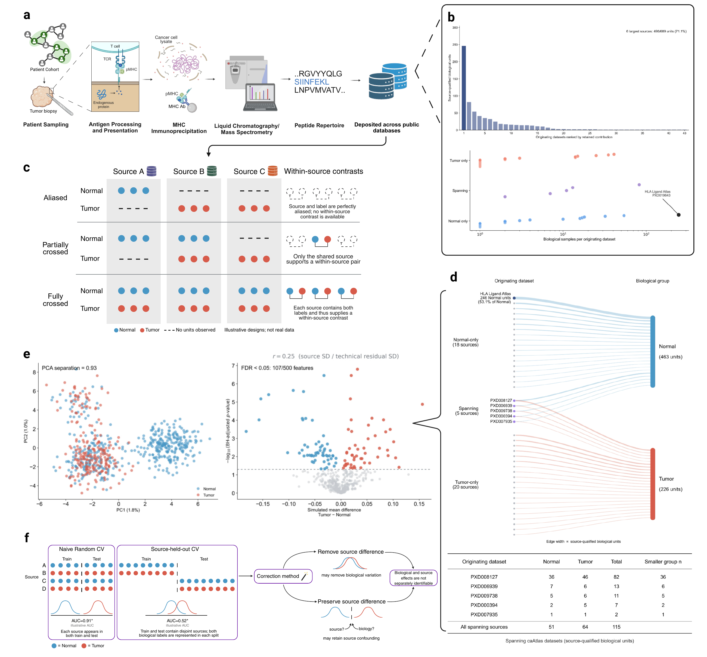

# Provenance Aliasing Diagnostics

`provenance-aliasing-diagnostics` reads metadata, checks the source and group assignments, and calculates entropy, crossing, source-removal, and binary prediction-ceiling diagnostics. Sources can be studies, batches, or another level of provenance chosen for the analysis. The diagnostics use metadata alone.

The methods are described in *Putting provenance before inference: a framework for assessing biological comparison in molecular atlases* (submitted manuscript).

**Status:** pre-alpha (`0.1.0.dev0`). Configuration and report formats use schema version `0.1-draft` and may change.

## Contents

- [Introduction](#introduction)
- [Installation](#installation)
- [Quick start](#quick-start)
- [Preparing your metadata](#preparing-your-metadata)
- [Configuration](#configuration)
- [Understanding the diagnostics](#understanding-the-diagnostics)
- [Python API](#python-api)
- [Reports and execution status](#reports-and-execution-status)
- [Run records and verification](#run-records-and-verification)
- [Scientific scope and limitations](#scientific-scope-and-limitations)
- [Troubleshooting](#troubleshooting)
- [Development and testing](#development-and-testing)
- [Citation, license, and support](#citation-license-and-support)

## Introduction

Integrated molecular atlases expand biological coverage and support predictive modeling. However, when biological groups originate from different studies, molecular differences may reflect study-associated variation. For example, when these atlases are constructed, they aggregate datasets which have been generated under different sampling designs, experimental workflows, with variations in biospecimen material, tissue processing techniques, immunoprecipitation protocols, mass-spectrometry acquisitions, and peptide identification procedures. Consequently, increasing the number of observations or increasing the number of biological coverage does not, by itself, provvide comparisons between groups within the same source or label. 

Provenance aliasing describes the statistical dependence between source membership and the labels used for a biological comparison. Since it concerns the structuer of the assembled data and its associated provenance structure, it does not rely on the observation of molecular measurements. Fully-crossed designs provide within-source contrasts in every source, partially crossed designs contain a contrast in a subset of sources, and under complete aliasing, source and group effects cannot be separate since they are inextricably linked to each other even if correction methods are applied. 

This package quantifies the degree of provenance aliasing in a heterogeneously assembled atlas prior to feature-level analysis or predictive modeling. Given a provenance resolution, unit definition, group assignment, and weighting scheme, the package provides tools for residual label entropy, within-source comparison identifiers, sensitivity to source removal, and binary prediction upper ceiling under marginal output-source independence. These metadata diagnostics characterize the support for an intended comparison and complement and validate biological inference before analysis. 

[](docs/figures/figure_1_nature.pdf)

**Figure 1. Provenance structure and biological comparison in molecular atlases.** (a) Immunopeptidomics workflow from patient sampling to public data deposition. (b, d) Source contributions and allocation of source-qualified biological units to Normal and Tumor groups in the manuscript's atlas example. (c) Schematic aliased, partially crossed, and fully crossed designs and their available within-source contrasts. (e) Simulated feature patterns and differential-analysis results. (f) Illustrative random and source-held-out validation, and the ambiguity of correction when source and biological group are aliased. The AUC values in panel f are illustrative, rather than measured package performance. [View the original PDF](docs/figures/figure_1_nature.pdf).

## Installation

**Python 3.11 or newer** is required. CI is configured to test Python 3.11 and 3.12 on Linux, Windows, and macOS.

Install from the repository root, preferably in a virtual environment:

```sh
python -m pip install .
```

The base installation includes NumPy, pandas, and SciPy.

To use the Excel adapter, install the optional dependency:

```sh
python -m pip install ".[excel]"
```

The command line reads UTF-8 CSV and TSV files. For Excel files, use `provenance_aliasing.adapters.from_excel` in Python.

Check the installation:

```sh
provenance-aliasing --help
provenance-aliasing --version
```

You can also run the same commands through Python:

```sh
python -m provenance_aliasing
python -m provenance_aliasing.api
```

## Quick start

After installation, run these commands from the repository root. They work in PowerShell and POSIX shells.

### 1. Validate the example metadata

```sh
provenance-aliasing validate tests/fixtures/synthetic/bulk-rna-seq.csv --config tests/fixtures/synthetic/bulk-rna-seq.mapping.json --output validation.json
```

This checks the mapped columns, identifiers, weights, duplicates, and parent relationships. Diagnostics aren't calculated just yet.

### 2. Run the diagnostics

```sh
provenance-aliasing diagnose tests/fixtures/synthetic/bulk-rna-seq.csv --config tests/fixtures/synthetic/bulk-rna-seq.mapping.json --output diagnostics.json --run-record run-record.json
```

This creates:

| File | Contents |
|---|---|
| `diagnostics.json` | Validation results, settings including defaults, metrics, tables, and a record of how rows were prepared |
| `run-record.json` | Input and report hashes, settings, software versions, and the analysis exit code |

`diagnose` also validates the metadata, so a separate validation run is optional.

### 3. Verify the saved inputs and report

```sh
provenance-aliasing verify run-record.json --metadata tests/fixtures/synthetic/bulk-rna-seq.csv --config tests/fixtures/synthetic/bulk-rna-seq.mapping.json --report diagnostics.json --output verification.json
```

This checks whether the inputs and report match the saved record without rerunning the analysis.

Existing output files require `--overwrite`, and the directory must already exist.

### Example data and expected results

The example contains six samples across three studies:

```csv
study_id,sample_id,condition,donor_id
SYN-RNA-01,001,Control,D01
SYN-RNA-01,002,Control,D02
SYN-RNA-02,001,Control,D01
SYN-RNA-02,002,Case,D01
SYN-RNA-03,001,Case,D01
SYN-RNA-03,002,Case,D02
```

Only the middle study contains both conditions.

| Selected diagnostic | Expected value |
|---|---:|
| `design.n_sources` | 3 |
| `design.n_units` | 6 |
| `design.n_groups` | 2 |
| `structure.n_spanning_sources` | 1 |
| `entropy.ratio` | 1/3 |
| `ceiling.balanced_accuracy` | 2/3 |

These results are calculated from the example’s metadata. The balanced-accuracy ceiling is a theoretical bound, rather than the measured accuracy of a trained classifier. The other examples in `tests/fixtures/synthetic/` cover immunopeptidomics, metabolomics, and single-cell metadata. All are synthetic and separate from the datasets analyzed in the manuscript.

## Preparing your metadata

Each row links an analysis unit, a provenance source, and a group.

| Role | Meaning | Examples |
|---|---|---|
| Source | Where an observation came from | Study, laboratory, or acquisition batch |
| Unit | What the observation represents | Specimen, sample, or cell |
| Group | The label used in the comparison | Condition, tissue category, or cell type |
| Hierarchy, optional | How units relate to their parents | Donor of a specimen or sample of a cell |

Choose one source level (the provenance grain) and one unit definition per run. For example, study-level and acquisition-batch-level analyses answer different questions.

### Identifiers and composite keys

Each role can use one column or a combination of columns. In the example, sample IDs repeat between studies, so both columns are needed to identify a sample:

```json
"unit": ["study_id", "sample_id"]
```

If the same specimen appears in several studies, including the study in its unit key would instead count those appearances as different units. Choose the key to match the identity you want to track.

Identifiers are read as text, preserving leading zeros. Leading and trailing whitespace is trimmed from keys.

### Group assignments and parent relationships

Each unit must have the same group assignment wherever it appears. At each hierarchy level, it can have at most one nonmissing parent key.

Parent columns record relationships. They do not aggregate the data or change the analysis unit. Several samples from one donor remain several samples, not independent donors.

Some manuscript analyses count record-label assignments, including records with more than one label. The current metadata API requires one group per unit. Make sure to decide how to handle multiple labels before using it, and document that choice. Adding the label to a unit key just to pass validation can make one record appear to be several distinct units.

### Counting units and weights

The package adds row weights within each source/group cell, then divides by the total weight to calculate the probabilities used for entropy and the ceiling. These are proportions of the weighted records, not probabilities from independent biological sampling.

If you use a weight column, explain what the values represent and how they were assigned in `weighting.description`. For example, if the weights count acquisition files, distinguish this from counting specimens (as one specimen may produce several files).

## Configuration

The JSON mapping tells the package which columns identify sources, units, and groups, and which settings to use. This complete mapping works with the example table:

```json
{
  "schema_version": "0.1-draft",
  "name": "study-condition-audit",
  "columns": {
    "source": ["study_id"],
    "unit": ["study_id", "sample_id"],
    "group": ["condition"]
  },
  "grain": {
    "name": "study",
    "description": "Contributing study at the declared provenance grain."
  },
  "unit_description": "A specimen-level sample identified within its study.",
  "weighting": {
    "mode": "incidence"
  },
  "hierarchy": {
    "donor": ["study_id", "donor_id"]
  },
  "policies": {
    "missing_required": "error",
    "duplicates": "error",
    "missing_parent": "report",
    "missing_tokens": []
  },
  "diagnostics": {
    "include": [
      "design",
      "entropy",
      "ceiling",
      "structure",
      "guards"
    ],
    "bootstrap_replicates": 0,
    "seed": 0
  },
  "execution": {
    "max_working_memory_mb": 512
  }
}
```

Save the mapping as `mapping.json`, then use:

```sh
provenance-aliasing diagnose metadata.csv --config mapping.json --output diagnostics.json
```

### Missing values and duplicates

| Setting | Default | Alternatives |
|---|---|---|
| `policies.missing_required` | `error` | `drop` excludes records with missing source, unit, or group keys |
| `policies.duplicates` | `error` | `collapse_identical` retains one representative, while `keep_records` retains every record and its weight |
| `policies.missing_parent` | `report` | `error` makes validation fail if any parent keys are missing |
| `policies.missing_tokens` | `[]` | List additional strings to treat as missing |

Empty key values are missing. Literal `NA` is preserved by default. The identifiers `none`, `nan`, and `<na>` are reserved case-insensitively and must be renamed or explicitly declared missing.

`collapse_identical` checks the metadata and weights before keeping the first copy. With `keep_records`, each copy contributes its weight. Neither option resolves conflicting group assignments.

Validation leaves the input unchanged and returns a report, not a cleaned table. Diagnosis applies the chosen policies and records which rows were retained, excluded, or normalized.

### Column-based weights

To use a numeric weight column, replace the weighting section with:

```json
"weighting": {
  "mode": "column",
  "column": "observation_weight",
  "description": "Scientific meaning of the weight assigned to each record."
}
```

Weights must be finite and nonnegative, and their sum after preparation must be positive. Rows with zero weight still count in structural summaries, so a source can contain records from both groups while contributing positive weight to only one.

### Source sensitivity and bootstrap settings

Add `entropy_loso` to `diagnostics.include` to calculate entropy changes after removing each source.

Set `diagnostics.bootstrap_replicates` to a positive integer to resample sources with replacement. This setting enables bootstrap even if `entropy` is absent from `diagnostics.include`.

The default seed is `0`. The report separates usable replicates from those with an undefined entropy ratio. The percentile range summarizes how the entropy ratio varies when sources are resampled. Whether this range is a valid confidence interval depends on the study’s sampling design and the assumptions behind the bootstrap.

Accepted configuration values and defaults are defined in `api/config.py`.

## Understanding the diagnostics

**Provenance aliasing** means that group labels are statistically associated with their sources. For example, cases may come mainly from one set of studies and controls from another. This can happen even if all studies use the same measurement procedures. Batch effects refer to systematic measurement differences between experiments.

The available diagnostics are:

| Family | Main purpose |
|---|---|
| `design` | Count sources, units, groups, retained/excluded records, and total mass |
| `entropy` | Quantify residual label entropy and identify source contributions |
| `ceiling` | Compute the exact binary balanced-accuracy ceiling under marginal output–source independence |
| `structure` | Describe sources spanning groups, within-group source sharing, and structural effects of source removal |
| `guards` | Report Cramer’s V, small-source counts, and source/group design-rank diagnostics |
| `entropy_loso` | Assess how removing individual sources changes the entropy ratio |

The default selection includes all listed families except `entropy_loso`.

### Residual label entropy

The manuscript’s normalized conditional entropy is:

```text
R_meta = H(G | D) / H(G)
```

Here, `G` denotes the group label and `D` denotes the source. The report lists this ratio as `entropy.ratio`.

When marginal group entropy is positive:

- `R_meta = 0`: no within-source label entropy remains
- `R_meta = 1`: knowing the source gives no information about the group under the chosen weights
- Intermediate values describe partial source–label dependence

The ratio describes the fraction of label entropy remaining after conditioning on source and is defined only when `H(G) > 0`. Biological signal, causal confounding, and statistical power require separate analyses with their own assumptions.

The `entropy.per_source` table shows how much each source contributes to `H(G|D)`, in bits. To obtain the manuscript’s contribution share `S_d`, divide by total `H(G|D)` when it is positive.

### Conditional binary prediction ceiling

Look for `ceiling.balanced_accuracy` in the report. The manuscript calls this `C_inv`.

The calculation requires two groups, each with positive total weight. It asks how high balanced accuracy could be if predictions had the same positive-call rate in every source with positive weight. This constraint is marginal output–source independence, also called statistical parity.

Using the same weights for the constraint and accuracy:

- The ceiling is `0.5` when no positive-mass source contains both groups
- It is `1` when every positive-mass source has the same group composition

The package finds the exact maximum by evaluating the endpoints and each source’s group proportion. It optimizes over joint distributions of predictions, labels, and sources without requiring predictions to be obtainable from measured features.

Whether a molecular classifier can reach the ceiling depends on what it can predict from the measured features. Performance on unseen studies requires separate evaluation because predictions may still depend on source. Accuracy below the ceiling establishes neither source independence nor biological validity. An observed result above the ceiling is not, by itself, a calibrated test of population dependence.

### Binary contrasts and multiple labels

For a pairwise analysis, filter the metadata to the two labels before running diagnosis. Keep the unit identities and weights consistent with your analysis as the package recalculates the distribution using the filtered rows. You must select the label pair and make any decisions about combining labels before passing the data to the package.

Having a source that contains both labels provides direct pairwise support. A full additive model with several labels may also estimate indirect comparisons through intermediate labels, subject to its assumptions.

## Python API

In Python, load the mapping and pass it with the metadata:

```python
import pandas as pd
from provenance_aliasing.api import AnalysisConfig, diagnose, validate

metadata = pd.read_csv(
    "tests/fixtures/synthetic/bulk-rna-seq.csv",
    dtype=str,
    keep_default_na=False,
)

config = AnalysisConfig.from_json(
    "tests/fixtures/synthetic/bulk-rna-seq.mapping.json"
)

validation = validate(metadata, config=config)
validation.raise_for_errors()

result = diagnose(metadata, config=config)

print(result.metrics)
print(result.to_json())
```

`diagnose` validates the data before calculating results. Invalid metadata raises `MetadataValidationError`, which includes the validation report. Unexpected calculation failures raise `DiagnosticComputationError`. Quantities that are undefined, inapplicable, unrequested, or over budget receive statuses instead.

Use `run_analysis` and `verify_run` from `provenance_aliasing.api` to work with run records. File inputs get byte-level hashes. A DataFrame has no original-file hash.

Import `diagnose` from `provenance_aliasing.api` for this workflow. The function at `provenance_aliasing.diagnose` is the lower-level corpus-report API.

## Reports and execution status

Diagnostic reports contain:

| Field | Contents |
|---|---|
| `config` | Settings used, including defaults |
| `validation` | Validation counts and structured issues |
| `metrics` | Metric identifiers, values, statuses, reasons, and weighting descriptions |
| `tables` | Detailed results and the prepared observations |
| `audit` | What happened to each input row and where it appears in the prepared table |

Tables use `columns`, `index`, `index_names`, `data`, and `attrs` fields.

Validation issue `row_positions` are zero-based data-record positions, excluding the header.

### Metric statuses

| Status | Meaning |
|---|---|
| `ok` | A numeric result was computed |
| `undefined` | The quantity has no defined value for this design |
| `not_applicable` | Requirements are unmet, such as a binary ceiling for three groups |
| `not_requested` | The calculation was not selected |
| `resource_limited` | Estimated numerical working memory exceeds the configured budget |

Unavailable values are JSON `null`, not zero.

### Resource budget

`execution.max_working_memory_mb` defaults to `512`.

Before each stage, the package estimates the memory needed for additional numerical arrays. Stages whose estimates exceed the budget are marked `resource_limited`, and the package keeps the results from other stages. The budget applies only to these estimates and does not limit total process memory or runtime.

Stage estimates and execution statuses appear in `tables["execution.stages"]`.

### Command-line behavior

Without `--output`, JSON is written to stdout. Summaries and errors go to stderr.

Useful options include:

| Option | Purpose |
|---|---|
| `--config PATH` | Required JSON mapping for validation and diagnosis |
| `--format csv` or `--format tsv` | Override file-format inference |
| `--output PATH` | Write the report to a file |
| `--run-record PATH` | Write a companion record for validation or diagnosis |
| `--overwrite` | Permit replacement of existing output files |
| `--quiet` | Suppress summaries and warnings while retaining error messages |

Input files are protected from replacement.

| Exit code | Meaning |
|---|---|
| `0` | Command completed or verification matched (warnings and unavailable metrics may still exist) |
| `2` | Invalid input, configuration, usage, or verification mismatch |
| `3` | Computation, run-record, or report-output failure |
| `4` | Resource-limited partial diagnosis (available results are preserved) |

Invalid mapped metadata produces a validation report. Unreadable files, malformed tables, or invalid configuration may prevent report creation.

## Run records and verification

Run records capture:

- Exact input-file byte sizes and SHA-256 fingerprints when files are supplied
- Resolved configuration and its fingerprint
- Command and analysis exit code
- Python, package, NumPy, and pandas versions
- A fingerprint of the report’s canonical JSON content

Input hashes cover exact bytes, so line-ending or formatting changes can cause a mismatch. Report hashes use canonical JSON, so whitespace and object-key order do not affect the match.

Supply `--report` to check the report as well as the inputs. Software-version differences are reported separately and do not by themselves make the content check fail.

A match tells you that the supplied content agrees with the saved record. Verification does not rerun calculations, authenticate the data, or establish scientific correctness.

The record includes only the versions listed above. To save a fuller dependency list, run:

```sh
python -m pip freeze > environment.txt
```

Reports contain identifiers and prepared observations from the metadata. Check their contents before sharing them.

## Scientific scope and limitations

A study containing both groups gives you a place to look for a within-study comparison. You still need to check the specimens, donor relationships, preparation, and acquisition methods. Crossing alone does not establish comparable materials, independent replication, or enough power to detect an effect.

If each source contains only one of two labels, a binary additive model with unrestricted source effects cannot separate the group effect from the source effects. Adding more observations to those same uncrossed sources does not solve the problem.

Report the source level, unit definition, labels, weights, missing-value and duplicate policies, and data release alongside the results. The calculations depend on those choices and on the accuracy of the metadata.

This repository contains the metadata diagnostic package. The manuscript’s specimen-comparability review, molecular prediction, and paired-peptide analyses are separate workflows. The files here are not a complete reproduction bundle for its atlas results or figures.

## Troubleshooting

| Problem | Suggested check |
|---|---|
| Command is unavailable | Confirm installation in the active environment, or use `python -m provenance_aliasing.api` |
| Missing configured columns | Compare the mapping with the table headers |
| Conflicting group assignments | Inspect the unit definition and label assignments (duplicate policies do not resolve this conflict) |
| Duplicate observations | Review repeated source/unit/group keys before choosing a duplicate policy |
| Ceiling is `not_applicable` | Confirm that exactly two groups remain and both have positive mass |
| Entropy ratio is `undefined` | Check whether marginal group entropy is zero |
| Results are `resource_limited` | Inspect execution-stage estimates and the configured budget |
| Existing output cannot be replaced | Choose a new output name or use `--overwrite` |
| Verification fails after editing a file | Compare exact input bytes and resolved settings with the saved record |

Use `--help` on an individual command for its available options.

## Development and testing

Install development and optional Excel dependencies:

```sh
python -m pip install ".[dev,excel]"
python -m pytest
```

The tests cover configuration, metadata checks and preparation, calculations, JSON exports, commands, run records, and synthetic examples.

The source directories map to the installed package as follows:

| Directory | Purpose |
|---|---|
| `core/` | Numerical functions and adapters, installed under `provenance_aliasing` |
| `api/` | Configuration, validation, diagnosis, results, CLI, and run records, installed under `provenance_aliasing.api` |
| `tests/` | Tests and synthetic fixtures |
| `scripts/` | Distribution checks and installed-wheel smoke checks |
| `docs/figures/` | Publication figures and README previews |
| `.github/workflows/` | Test and packaging workflows |

## Citation, license, and support

**Associated manuscript**

YongJin Lee, Jeannine Yu, Ryan Lim, Judy Lee, Valerie Jun, Maggie De Leon, Yunseo Ko, and Louis-S. Bouchard. *Putting provenance before inference: a framework for assessing biological comparison in molecular atlases*. Submitted manuscript.

**License**

N/A

**Support**

Report bugs and questions through [GitHub Issues](https://github.com/UCLAbouchardlab/provenance-aliasing-diagnostics/issues). For bug reports, include the package version, command or API call, error message, and a minimal shareable example.
